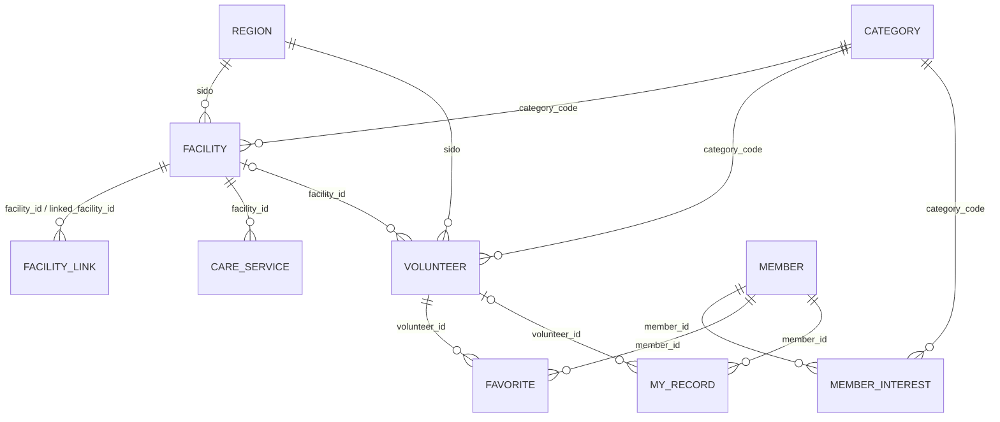

# VolunteerIntegration (라이프드롭)

흩어진 봉사 정보를 한곳에서 찾는 **통합 자원봉사 웹 플랫폼**.
Spring Boot 3 · Thymeleaf · **Oracle** · JdbcTemplate

## 1. 실행 방법

**SQL 도구가 없어도 됩니다.** Oracle DB만 켜져 있으면 서버가 처음 실행될 때 테이블 생성과 공공데이터 적재를 알아서 합니다.

| 단계 | 할 일 |
|---|---|
| 1 | Oracle DB 서비스가 실행 중인지 확인 (Windows 서비스 `OracleServiceXE`, `OracleOraDB21Home1TNSListener`) |
| 2 | `src/main/resources/application.yml` 의 `url / username / password` 를 내 Oracle에 맞게 수정 |
| 3 | IntelliJ에서 `VolunteerIntegrationApplication` 실행 (또는 `gradlew.bat bootRun`) |
| 4 | 첫 실행: 테이블 10개 자동 생성 → CSV 4종 자동 적재 (1~2분) |
| 5 | http://localhost:8080 접속 |

**계정**
- 가장 간단한 방법: `username: system`, `password: 설치 때 정한 비밀번호` → SYSTEM 계정 안에 테이블이 만들어짐
- 전용 계정을 쓰려면 SYSTEM으로 `sql/00_create_user.sql` 을 한 번 실행한 뒤 `volunteer / volunteer` 사용
  (Oracle DB를 설치했다면 `sqlplus` 가 같이 깔려 있다: `sqlplus system/비번@localhost:1521/XEPDB1` → `@sql/00_create_user.sql`)

**접속 URL**
- Oracle XE 18c/21c: `jdbc:oracle:thin:@localhost:1521/XEPDB1` (기본값)
- Oracle 11g XE 또는 SID 방식: `jdbc:oracle:thin:@localhost:1521:XE`
- Enterprise/Standard 등: `jdbc:oracle:thin:@localhost:1521/서비스이름` (보통 `ORCL` 또는 `ORCLPDB`)

**다시 처음부터**: `sql/99_drop.sql` 실행 후 서버 재시작 → 테이블·데이터가 다시 만들어짐
**테스트**: `gradlew.bat test` (DB 없이 도는 단위 테스트)

## 2. 화면과 기능

| URL | 화면 | 기능 |
|---|---|---|
| `/` | 홈 | 통합 검색창, 카테고리 5종(분야별 건수), 데이터 현황, 최근 봉사 |
| `/search` | 봉사 찾기 | 한 줄 검색(`강남구 환경정화` → 지역/분야/키워드 자동 분리), 지역·분야·날짜 필터, 정렬 4종, 페이징 |
| `/volunteers/{id}` | 봉사 상세 | 활동 정보, 연결된 시설·카카오맵, 관심 봉사 담기, 내 기록에 바로 추가, 같은 기관 활동 |
| `/facilities` | 시설 찾기 | 통합 시설 5.6만 곳 검색 (지역·분야·출처 필터) |
| `/facilities/{id}` | 시설 상세 | 기본 정보, 같은 기관(출처 간 연계), 돌봄 서비스 프로그램, 이 시설의 봉사 |
| `/blood` | 헌혈의 집 | 전국 154곳을 시·도별로, 카카오맵 연결 |
| `/login` `/signup` | 계정 | BCrypt 암호화, 세션 로그인, 오픈 리다이렉트 방지 |
| `/mypage` | 마이페이지 | 대시보드(봉사시간·헌혈·기부), 월별 봉사시간 그래프, 기록 추가/삭제, 관심 봉사, **맞춤 추천**, 내 정보·관심 분야, 탈퇴 |

맞춤 추천은 AI 모델 없이 SQL 점수로 순위를 매긴다: 관심 분야 일치 +3, 내 시·도 일치 +2, 내가 기록한 봉사와 같은 분야 +1.

## 3. 프로젝트 구조

```
src/main/java/com/volunteerintegration
├── domain/      Category(분야·키워드 분류), Region(시·도 표기 통일)  ← 순수 자바
├── loader/      CsvReader, PublicDataParser(CSV→행)  ← 순수 자바
│                SchemaInitializer(테이블 자동 생성), DataLoader(오라클 batch 적재)
├── volunteer/   검색 조건, SearchQuery(검색어 분석), Repository, Controller
├── facility/    시설·헌혈의 집·돌봄 서비스
├── member/      회원 Repository/Service
├── auth/        로그인·회원가입 폼과 Controller
├── mypage/      기록·찜·대시보드·추천
├── config/      LoginInterceptor(로그인 필요 경로), 공통 모델, BCrypt Bean
└── common/      PageResult, LoginMember, JdbcSupport
sql/             00_create_user(선택) · 99_drop(초기화)
src/main/resources/db/schema.sql   테이블 생성 SQL (서버가 자동 실행)
data/            공공데이터 CSV 4종
```

- **계층**: Controller → Service(@Transactional) → Repository(JdbcTemplate, SQL 직접 작성)
- **SQL 안전**: 모든 값은 바인드 변수(`?`), LIKE는 `%`, `_` 이스케이프
- **폼 처리**: Bean Validation + PRG(Post-Redirect-Get) 패턴, 오류는 flash로 유지

## 4. ERD



| 테이블 | 건수 | 설명 |
|---|---|---|
| facility | 55,920 | 사회복지시설 41,135 · VMS 봉사활동처 13,281 · 청소년활동 864 · 청소년지원 486 · 헌혈의집 154 |
| facility_link | 9,612 | VMS 봉사활동처 ↔ 사회복지·청소년시설 (같은 기관) |
| care_service | 2,109 | 돌봄 서비스 프로그램 → 시설 |
| volunteer | 23,898 | 1365 실적 31,021행을 활동명·기관·일시로 묶은 것 (participant_count = 묶인 행 수) |
| member / member_interest / favorite / my_record | – | 회원 기능 |

## 5. 데이터 처리 규칙

- **시·도 통일**: `서울특별시 / 서울 / 서울시` → `서울`, `강원도 / 강원특별자치도` → `강원`
  - 2026년 주소 `전남광주통합특별시 OO구` → 광주, `OO시·군` → 전남 (1365 데이터와 같은 기준으로 필터하기 위해)
  - 시·도 칸이 빈 시설 9,473곳은 주소 첫 단어로 채움
- **분야 분류**: 1365 데이터에 분야 컬럼이 없어 활동명·내용·기관명 키워드로 분류
  (교육 9,978 · 안내/기타 7,427 · 돌봄 3,215 · 환경 2,530 · 재능 690 · 헌혈 58)
- **날짜**: `20211231` 과 `2016-11-14` 두 형식 모두 DATE로 변환

## 6. 공공데이터 현황 — 없는 데이터

| 기획 기능 | 상태 | 필요한 것 |
|---|---|---|
| 혈액 보유 현황 (홈 상단, 혈액 부족 알림) | ❌ 데이터 없음 | 대한적십자사 혈액 보유 현황 데이터/API |
| 기부 캠페인 달성률 | ❌ 데이터 없음 | 기부 캠페인 데이터 (공공데이터에 마땅한 것이 없으면 관리자 입력 기능) |
| **현재 모집 중인** 봉사 | ⚠️ 과거 실적만 있음 | 지금 CSV는 2021.12~2022.01 **실적** 데이터라 모집 기간·인원·신청 URL이 없음 → 1365 봉사 모집 정보 OpenAPI |
| 지도 핀 · 길찾기 | ⚠️ 좌표 부족 | 위·경도가 있는 시설은 1,350곳뿐(청소년시설만), 헌혈의 집은 0곳 → 카카오 로컬 API로 주소→좌표 변환 후 저장 |
| 1365 봉사 ↔ 시설 연결 | ⚠️ 11.8% | 기관명 일치로 2,824건만 연결 → 주소·지역코드 매칭 추가 |
| 헌혈의 집 운영시간 | ❌ 데이터 없음 | 대한적십자사 헌혈의 집 상세 정보 |

지금은 좌표가 없어도 되도록 **카카오맵 주소 검색 링크**로 위치를 보여 주고, 신청은 **1365 포털로 연결**한다.
